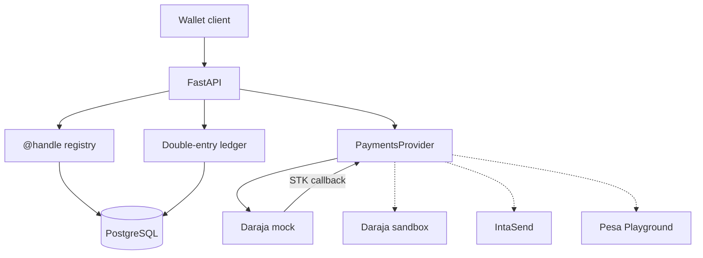
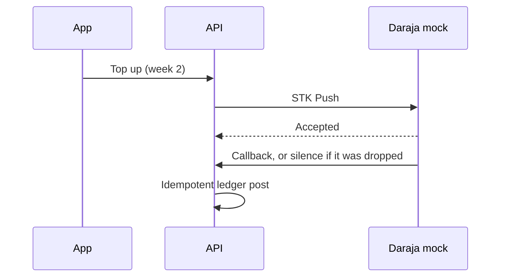

# X Money for Kenya

A sandbox prototype of a pay-by-**@handle** wallet: people register a case-insensitive handle and a Kenyan mobile number, each gets a wallet, and a double-entry ledger records value in integer Kenya-shilling cents. Later weeks connect top-ups and cash-outs to M-PESA. This week builds the foundation those flows will sit on.

> **Sandbox only. This is not a payment service.**
>
> X Money for Kenya does not hold a Central Bank of Kenya licence, is not affiliated with X, Safaricom, or IntaSend, and **cannot move real money**. The process refuses to start unless sandbox mode is on, and the Daraja client refuses the production host `api.safaricom.co.ke`. Nothing in this repository is an offer to store, transmit, or settle customer funds.

## What a Kenya launch would need

The software in this repo is the shape of a wallet, not permission to run one. A real launch would still need, and this project does not provide:

- Central Bank of Kenya authorisation, or a written arrangement with a licensed payment service provider.
- A production M-PESA agreement: a paybill or shortcode, settlement accounts, and Daraja credentials that are not the public sandbox.
- Customer identification and suspicious-transaction reporting under the Proceeds of Crime and Anti-Money Laundering Act.
- Registration and duties under the Data Protection Act, 2019 (Office of the Data Protection Commissioner).
- Safeguarding of customer funds, a complaints process, and clear consumer disclosure.

Week 5 of the roadmap is a write-up of that gap. It is not a shortcut through it.

## Architecture



Solid arrows are week 1. Dashed arrows are the same `PaymentsProvider` seam, not wired yet.

The week 2 top-up, which this repo does **not** post into the ledger yet:



## Ledger

Money is an integer number of **cents**. 1 KES = 100 cents. There are no floats. M-PESA itself collects whole shillings, so the STK adapter rejects an amount that is not divisible by 100. The ledger keeps cents so a later fee can be a fraction of a shilling without ever leaving integers.

Balances are not a column. They are the sum of postings. Asset and expense accounts are debit-normal. Liability, equity, and income accounts are credit-normal. A wallet is a liability: we would owe the customer that balance.

| Account | Type | What it is for |
| --- | --- | --- |
| `system:mpesa_float` | Asset | Cash held at M-PESA |
| `system:mpesa_clearing` | Asset | STK or B2C value still in flight |
| `system:fees` | Income | Fees |
| `system:suspense` | Liability | Value we owe but cannot apply to a wallet yet |
| `wallet:{user}` | Liability | One wallet per registered handle |

A 100.00 KES collection with a 1.00 KES fee will eventually post as:

| Account | Debit (cents) | Credit (cents) |
| --- | ---: | ---: |
| M-PESA float | 10000 | |
| Wallet @amina | | 9900 |
| Fee income | | 100 |

Every journal entry has an idempotency key. Replaying the same key and the same postings returns the original entry and does not move balances again. The same key with a different body is a conflict. Posting order does not matter for that comparison.

PostgreSQL enforces the rules the application also checks:

- Debits equal credits, and there are at least two postings, via a deferred constraint trigger.
- Amounts are positive bigint cents.
- Postings, journal entries, and accounts cannot be updated or deleted.
- Handles are unique case-insensitively, phones are unique, and each user has one wallet.

Week 1 does **not** refuse an overdraft. A wallet can go negative. Spend limits arrive with peer transfers in week 3. The books still have to balance: total debits equal total credits, and the test suite checks that after every test.

`POST /v1/sandbox/journal-entries` exists so the ledger can be demonstrated. It is not the customer top-up API. Week 2 posts from the STK callback, not from this route.

## Handles

`POST /v1/users` takes a handle and a phone. The handle is stored lowercase, without `@`, and is unique regardless of case. It is 3–20 characters, starts with a letter, and may contain letters, digits, and underscores. Names such as `admin`, `mpesa`, and `xmoney` are reserved.

The phone must be E.164 for a Kenyan mobile: `+254` then `7` or `1` and eight more digits. Spaces and dashes are ignored. A local `07…` number is rejected so the stored form is always E.164.

`GET /v1/handles/{handle}` resolves a handle to its wallet. It does not return the phone number.

## M-PESA simulator

[Pesa Playground](https://github.com/OmentaElvis/pesa-playground) is a local M-PESA simulator and a good interactive tool. It is a Rust/Tauri desktop app (and a Docker image aimed at that UI), and its roadmap targets Daraja 3.0. It is not a Python library the test suite can import, and a GUI is the wrong place to assert that a callback was dropped. Week 1 therefore ships a small Daraja-compatible mock behind `PaymentsProvider`.

The adapter is `DarajaHttpProvider`. Point `base_url` at this mock today. The same client is what a later week will point at the Daraja sandbox (`sandbox.safaricom.co.ke` is allowed; `api.safaricom.co.ke` is not). An IntaSend adapter would implement the same protocol. The mock does not credit a wallet. That state machine is week 2.

The mock exposes:

- `GET /sandbox/daraja/oauth/v1/generate?grant_type=client_credentials` with HTTP Basic auth. Any non-empty key and secret work. The sample credentials are `sandbox` / `sandbox`.
- `POST /sandbox/daraja/mpesa/stkpush/v1/processrequest` with the usual Daraja body. The provider sends `X-Idempotency-Key`. Replaying it returns the same `CheckoutRequestID` and does not fire a second callback. A different body with the same key is HTTP 409.
- An asynchronous callback to `CallBackURL`.

The last three digits of the MSISDN pick the outcome. Any other number uses the default, which starts as success with no delay.

| Suffix | What the mock does |
| --- | --- |
| `000` | Success, ResultCode 0, receipt prefixed `SBOX` |
| `032` | Cancelled by the user, 1032 |
| `037` | Timeout, handset unreachable, 1037 |
| `001` | Insufficient funds, 1 |
| `099` | The push is accepted and the callback is never sent |
| anything else | The configured default |

`PUT /sandbox/daraja/__control/behavior` sets that default: `outcome` (`success`, `cancelled`, `timeout`, `insufficient_funds`), `delay_ms` (0–10000), and `drop_callback`. Suffix `099` still drops. Other suffixes still force their outcome, and they wait for the configured delay.

## Run it locally

Requirements: Docker, Python 3.12.

```bash
make setup
make up
make migrate
make run
```

The API listens on <http://127.0.0.1:8000>. Interactive docs are at <http://127.0.0.1:8000/docs>. `.env.example` lists the sandbox variables. `make setup` copies it to `.env` if you do not already have one.

```bash
curl -s localhost:8000/health

curl -s -X POST localhost:8000/v1/users \
  -H 'content-type: application/json' \
  -d '{"handle":"@amina","phone":"+254712345678"}'

curl -s localhost:8000/v1/handles/amina

curl -s -u sandbox:sandbox \
  'localhost:8000/sandbox/daraja/oauth/v1/generate?grant_type=client_credentials'
```

Every response carries `X-Sandbox: true` and `X-Moves-Real-Money: false`.

### Tests

```bash
make test
```

Pytest always uses the `xmoney_test` database, so a run does not wipe wallets in the dev database. The suite is serial: tests share one schema and truncate it between cases. GitHub Actions runs the same lint, migration, and pytest steps against Postgres 16.

Coverage that matters for a ledger:

- Derived balances, including a three-leg fee split.
- Idempotent replay, including the same postings in a different order, and a conflict when the body differs.
- Concurrent distinct posts sum exactly. Concurrent posts of one idempotency key apply once.
- The database, not only the service, rejects an unbalanced entry, an entry with no postings, a non-positive amount, and any update or delete of a posting.
- Two registrations of the same handle cannot both win.
- The mock delivers success, cancel, timeout, and insufficient-funds callbacks, waits when asked, and can drop a callback. A successful STK push does not create a ledger posting.

## Roadmap

| Week | What lands |
| --- | --- |
| 1 | This foundation: ledger, @handles, provider seam, Daraja mock |
| 2 | STK top-up with idempotency, a payment state machine, and callbacks |
| 3 | P2P transfers, B2C cash-out, and a reconciler |
| 4 | KYC tiers and fraud flags |
| 5 | Real sandbox credentials, failure tests, a load test, deploy, and the regulatory write-up |

## Layout

```text
src/xmoney/ledger/      accounts, journal, postings, balances
src/xmoney/identity/    handles, E.164 phones, wallet creation
src/xmoney/payments/    PaymentsProvider, Daraja client, local mock
alembic/                schema, triggers, and the seeded chart of accounts
tests/                  ledger, concurrency, handles, API, mock
```
