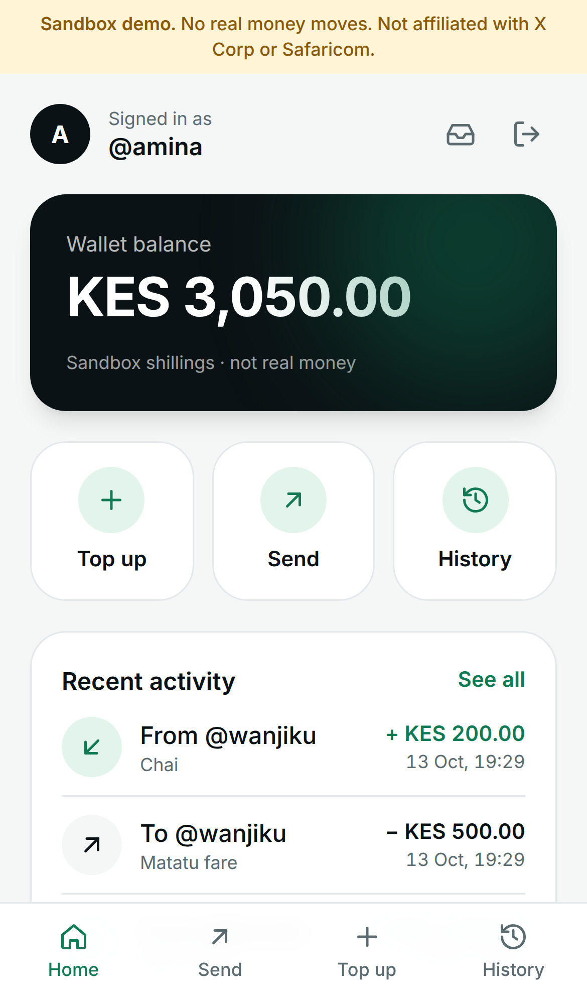
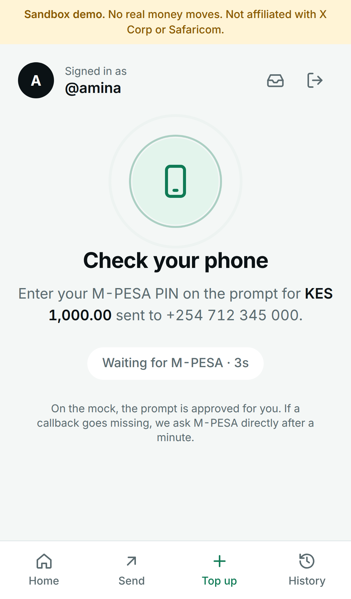
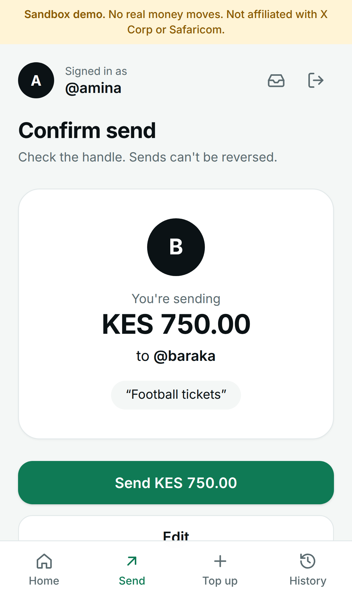
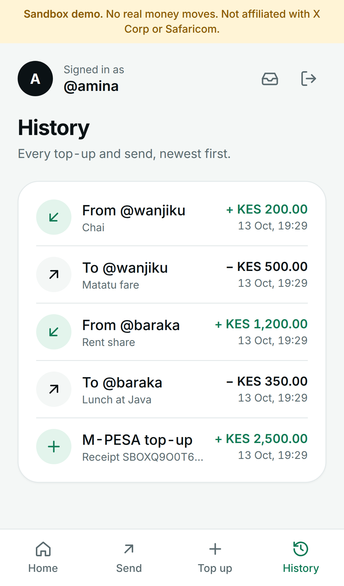
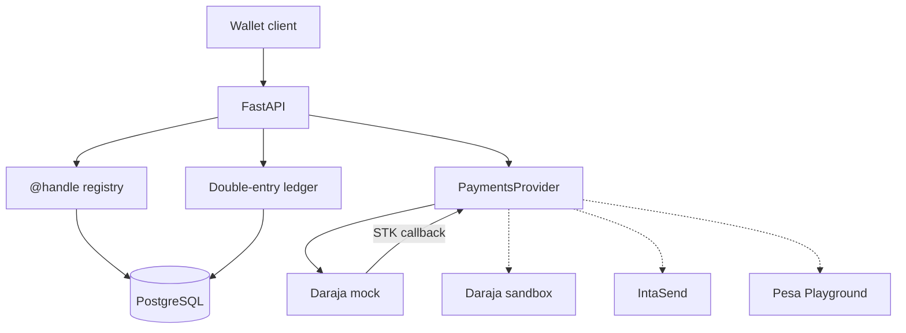
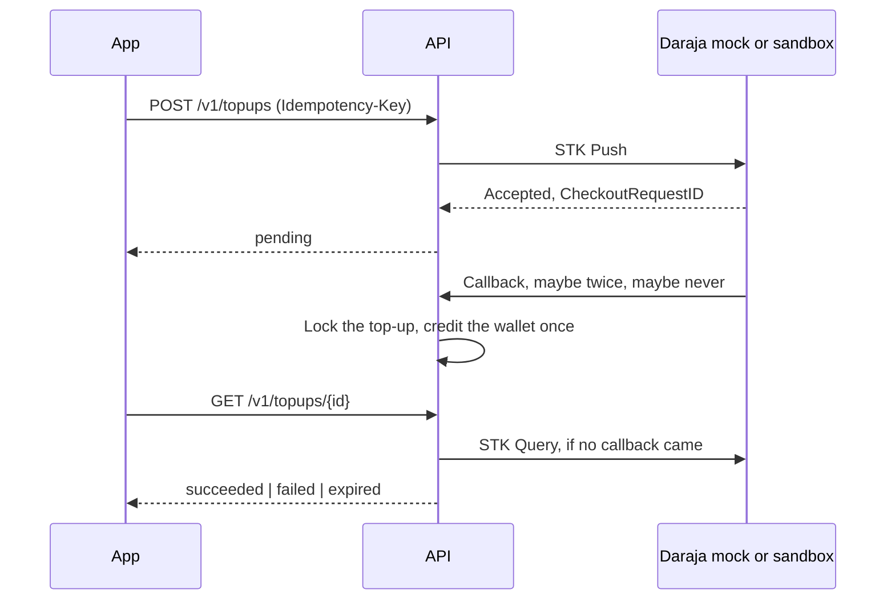
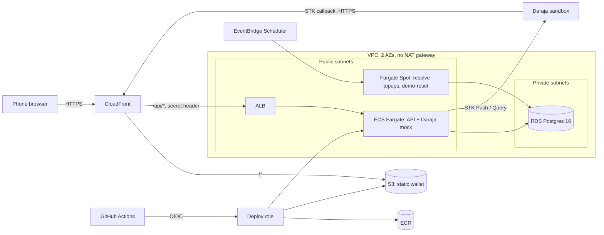

# X Money for Kenya

A sandbox prototype of a pay-by-**@handle** wallet: people register a case-insensitive handle and a Kenyan mobile number, each gets a wallet, and a double-entry ledger records value in integer Kenya-shilling cents. Later milestones connect top-ups and cash-outs to M-PESA. The code here today is the foundation those flows will sit on.

[](https://github.com/benweru/xmoney-kenya/actions/workflows/ci.yml)
[](docs/evidence/security-scans.md)
[](docs/evidence/hygiene.md)
[](docs/evidence/README.md)

> **Sandbox only. This is not a payment service, and it is not affiliated with X Corp.**
>
> "X Money for Kenya" is the name of an independent portfolio project. It is not built, endorsed, or sponsored by X Corp. (or its X Money product), Safaricom, or IntaSend. It does not hold a Central Bank of Kenya licence and **cannot move real money**. The process refuses to start unless sandbox mode is on, and both the settings loader and the Daraja client refuse every Safaricom host except `sandbox.safaricom.co.ke`. Nothing in this repository is an offer to store, transmit, or settle customer funds.

## The wallet app

A mobile-first PWA in [`web/`](web/): register with a handle, a phone, and a PIN, sign in with a code from the sandbox inbox, top up through an M-PESA STK prompt with a live status, send to an @handle, and read your history. `make demo` runs it on <http://localhost:3000> against the Daraja mock.

<p>
  
  
  
  
</p>

## What a Kenya launch would need

The software in this repo is the shape of a wallet, not permission to run one. A real launch would still need, and this project does not provide:

- Central Bank of Kenya authorisation, or a written arrangement with a licensed payment service provider.
- A production M-PESA agreement: a paybill or shortcode, settlement accounts, and Daraja credentials that are not the public sandbox.
- Customer identification and suspicious-transaction reporting under the Proceeds of Crime and Anti-Money Laundering Act.
- Registration and duties under the Data Protection Act, 2019 (Office of the Data Protection Commissioner).
- Safeguarding of customer funds, a complaints process, and clear consumer disclosure.

Milestone M4 of the roadmap is a write-up of that gap. It is not a shortcut through it.

## Repository layout

```text
api/        FastAPI backend: ledger, @handles, payments seam, Daraja mock, Alembic, pytest
web/        Next.js + TypeScript wallet PWA, Playwright e2e tests
infra/      Terraform for the AWS demo (bootstrap, foundation, app) and its scripts
docs/adr/   architecture decision records
docs/runbooks/  step-by-step operations: Daraja sandbox, first AWS deploy, AWS costs
docker/     Postgres init scripts for docker compose
```

Design decisions live in [`docs/adr/`](docs/adr/): [001 stack](docs/adr/001-stack-choice.md), [002 ledger](docs/adr/002-ledger-design.md), [003 AWS hosting](docs/adr/003-aws-hosting-terraform-later.md), [004 sign-in](docs/adr/004-pin-otp-sign-in.md), [005 STK top-ups](docs/adr/005-stk-topup-state-machine.md), [006 open-demo protections](docs/adr/006-open-demo-protections.md), [007 AWS IAM](docs/adr/007-aws-iam-design.md), [008 no NAT gateway](docs/adr/008-no-nat-gateway.md), [009 STK Query before credit](docs/adr/009-stk-query-before-credit.md), [010 no float lock](docs/adr/010-wallet-running-balance-no-float-lock.md).

## Architecture



Solid arrows are week 1. Dashed arrows are the same `PaymentsProvider` seam, not wired yet.

An STK top-up ([ADR 005](docs/adr/005-stk-topup-state-machine.md)):



## Ledger

Money is an integer number of **cents**. 1 KES = 100 cents. There are no floats. M-PESA itself collects whole shillings, so the STK adapter rejects an amount that is not divisible by 100. The ledger keeps cents so a later fee can be a fraction of a shilling without ever leaving integers.

Wallet balances are trigger-maintained running totals ([ADR 010](docs/adr/010-wallet-running-balance-no-float-lock.md)). System accounts such as `system:mpesa_float` still sum postings and are **not** locked on post, so top-ups for different wallets are not serialized on one hot row. Asset and expense accounts are debit-normal. Liability, equity, and income accounts are credit-normal. A wallet is a liability: we would owe the customer that balance.

| Account | Type | What it is for |
| --- | --- | --- |
| `system:mpesa_float` | Asset | Cash held at M-PESA |
| `system:mpesa_clearing` | Asset | STK or B2C value still in flight |
| `system:fees` | Income | Fees |
| `system:suspense` | Liability | Value we owe but cannot apply to a wallet yet |
| `wallet:{user}` | Liability | One wallet per registered handle |

A 100.00 KES collection with a 1.00 KES fee will eventually post as:

| Account | Debit (cents) | Credit (cents) |
| --- | ---: | ---: |
| M-PESA float | 10000 | |
| Wallet @amina | | 9900 |
| Fee income | | 100 |

Every journal entry has an idempotency key. Replaying the same key and the same postings returns the original entry and does not move balances again. The same key with a different body is a conflict. Posting order does not matter for that comparison.

PostgreSQL enforces the rules the application also checks:

- Debits equal credits, and there are at least two postings, via a deferred constraint trigger.
- Amounts are positive bigint cents.
- Postings, journal entries, and accounts cannot be updated, deleted, or truncated.
- Postings can only be added in the transaction that created their journal entry, so a committed entry cannot gain new lines later.
- Handles are unique case-insensitively, phones are unique, and each user has one wallet.

Customer flows never overdraw a wallet: a send is refused if the sender's balance, read under a lock, is too low (see [Sends](#sends)). The ledger itself does not forbid a negative account, so the local-development journal route below can still push a wallet negative. The books always balance: total debits equal total credits, and the test suite checks that after every test.

`POST /v1/sandbox/journal-entries` posts any balanced entry, so it can credit any wallet. It is **off by default** and answers 404. Set `SANDBOX_JOURNAL_ENABLED=true` in `api/.env` to use it on your machine; the API refuses to start with that flag on when `PUBLIC_BASE_URL` is `https://`, so the public demo cannot turn it on. It is not the customer top-up API. Top-ups post from the STK callback.

## Handles

`POST /v1/users` takes a handle, a phone, and a 4–6 digit PIN. The handle is stored lowercase, without `@`, and is unique regardless of case. It is 3–20 characters, starts with a letter, and may contain letters, digits, and underscores. Names such as `admin`, `mpesa`, and `xmoney` are reserved.

The phone must be E.164 for a Kenyan mobile: `+254` then `7` or `1` and eight more digits. Spaces and dashes are ignored. A local `07…` number is rejected so the stored form is always E.164.

`GET /v1/handles/{handle}` confirms that a handle is registered and returns only `{"handle": ...}`: no phone number, user id, or wallet id. Sends address people by handle, so nobody needs another person's internal ids.

## Balances

`GET /v1/me/balance` returns the signed-in user's wallet balance. `GET /v1/accounts/{id}/balance` also works, but only on your own wallet. Another user's wallet, a system account, and an id that does not exist all return the same `404 account_not_found`, so probing ids reveals nothing. Both routes need a session.

## Sign-in

Sign-in takes two steps, as in [ADR 004](docs/adr/004-pin-otp-sign-in.md):

1. `POST /v1/auth/sign-in` with the phone and PIN. On success, a 6-digit code goes to the **sandbox inbox** (the demo's stand-in for SMS), and the response carries a `challenge_id`.
2. `POST /v1/auth/verify` with the `challenge_id` and the code. The response sets an `httpOnly` session cookie, `xmoney_session`.

`GET /v1/me` returns the signed-in user. `POST /v1/auth/sign-out` revokes the session. PINs are stored only as Argon2id hashes, and trivial PINs such as `1111` and `1234` are refused. Five wrong PINs in a row lock sign-in for 15 minutes. A code lasts 5 minutes, allows 5 guesses, and works once. `GET /v1/sandbox/inbox?phone=…` lists the latest messages for a phone. Anyone can read it, which is acceptable only because this is a sandbox.

## Top-ups

`POST /v1/topups` (signed in, with an `Idempotency-Key` header) sends an STK Push for `amount_cents` to the user's phone, or to `phone` if given. M-PESA collects whole shillings, so the amount must be a multiple of 100 cents, up to KES 250,000. The response is `pending`. Poll `GET /v1/topups/{id}` until it is `succeeded`, `failed`, or `expired`.

- Daraja's callback goes to `/v1/payments/stk/callback/{token}`. Only the first final answer for a `CheckoutRequestID` changes anything. The status change and the wallet credit (debit `system:mpesa_float`, credit the wallet) commit in one transaction. Every callback, including duplicates, is kept in `stk_callbacks`.
- A callback that arrives before the push response has been saved is recorded as soon as the id is known, then confirmed with STK Query.
- If no callback has come after `STK_QUERY_AFTER_SECONDS` (60), reading the top-up asks Daraja's STK Query API, at most every 15 seconds. `make resolve-topups` does the same for every waiting top-up. After `STK_EXPIRE_AFTER_SECONDS` (300) with no answer, the top-up is `expired`. A late "paid" callback still credits it.
- Replaying an `Idempotency-Key` returns the same top-up. Reusing it for a different amount is a 409.
- Postgres enforces the allowed transitions, so `succeeded` can never go back to `pending`.

`make smoke-topup PHONE=+254712345000` runs one top-up through a running API. The [Daraja sandbox runbook](docs/runbooks/daraja-sandbox-top-up.md) does the same against Safaricom's sandbox with your own credentials.

## Cash-outs

`POST /v1/cashouts` (signed in, with an `Idempotency-Key` header) holds `amount_cents` on the wallet and queues a B2C payment to the user's phone, or to `phone` if given. The hold is debit wallet, credit `system:mpesa_clearing`. Poll `GET /v1/cashouts/{id}`.

- The outbox worker sends the B2C call. A paid result settles clearing into `system:mpesa_float`. A failed result releases the hold.
- A timeout (`037` on the mock, or Daraja's timeout URL) expires the cash-out and **leaves the hold**. A late paid result still settles.
- If B2C never accepts the request, the hold is released after `B2C_EXPIRE_AFTER_SECONDS` (300).
- Replay of the same `Idempotency-Key` returns the same cash-out.

## Sends

`POST /v1/transfers` (signed in, with an `Idempotency-Key` header) sends `amount_cents` to an @handle, with an optional `note` of up to 140 characters:

```json
{"to": "@baraka", "amount_cents": 25000, "note": "Lunch"}
```

- **No overdrafts.** Both wallets are locked (`SELECT … FOR UPDATE`) in account-id order, the order every ledger post uses. Then the sender's balance is read, and the journal entry and the `transfers` row are written in that same transaction. Concurrent sends from one wallet check the balance one at a time, and `@a → @b` racing `@b → @a` cannot deadlock. A refused send is `422 insufficient_funds` and writes nothing.
- **Idempotent.** Replaying a key returns the original transfer (HTTP 200). The same key with a different recipient, amount, or note is a 409. A key that was refused for insufficient funds can be retried after a top-up.
- Sending to yourself is refused, and so is an unknown handle (404). Transfers cannot be updated or deleted.

## Transaction history

`GET /v1/me/transactions` (signed in) lists the wallet's activity, newest first. Each item is one journal entry that touched the wallet:

```json
{"items": [{"id": "…", "kind": "transfer_out", "amount_cents": -25000, "counterparty": "baraka",
            "note": "Lunch", "mpesa_receipt": null, "created_at": "2026-10-13T09:41:07.123456Z"}],
 "next_cursor": "MjAyNi0xMC0xM1Qw…"}
```

- `kind` is `topup`, `transfer_in`, `transfer_out`, or `other` (sandbox journal entries). `amount_cents` is signed: positive into the wallet, negative out of it.
- **Cursor pagination.** `limit` is 1–100 (default 20). Pass `next_cursor` back as `cursor`; `null` means there are no more pages. The cursor is the last item's `(created_at, id)`, and pages are a keyset seek on the `ix_postings_account_history` index. Items posted while you page sort ahead of your cursor, so later pages never repeat or skip an item. Refresh from the top to see them. A cursor this API did not issue is `422 invalid_cursor`.

## Rate limits and the open demo

The public demo has no password, so the API limits request rates per client IP and per signed-in user ([ADR 006](docs/adr/006-open-demo-protections.md)). Over a limit, the answer is `429 rate_limited` with a `Retry-After` header. Counters live in a Postgres table, so every API task shares them, and they store hashes, not IPs.

| Limit | Per | Allowed |
| --- | --- | --- |
| Every `/v1` and `/sandbox` request | IP | 300 a minute |
| Register | IP | 10 an hour |
| Sign in, verify a code | IP | 20 each per 10 minutes |
| Read the sandbox inbox, look up a handle | IP | 60 each a minute |
| Start a top-up | user | 10 an hour |
| Send | user | 30 per 10 minutes |

- `TRUSTED_PROXY_HOPS` says how many proxies append to `X-Forwarded-For` (2 behind CloudFront and the ALB). At the default of 0 the header is ignored, so it cannot be forged.
- `TOPUP_MAX_CENTS` lowers the largest single top-up for the demo. It cannot be raised above KES 250,000.
- `DARAJA_MOCK_CONTROL_ENABLED=false` turns off the mock's control route, so one visitor cannot change outcomes for everyone.
- `RATE_LIMITS_ENABLED=false` turns the limits off. The test suite does that by default and turns them on in `tests/test_rate_limits.py`.

## M-PESA simulator

[Pesa Playground](https://github.com/OmentaElvis/pesa-playground) is a local M-PESA simulator and a good interactive tool. It is a Rust/Tauri desktop app (and a Docker image aimed at that UI), and its roadmap targets Daraja 3.0. It is not a Python library the test suite can import, and a GUI is the wrong place to assert that a callback was dropped. Week 1 therefore ships a small Daraja-compatible mock behind `PaymentsProvider`.

The adapter is `DarajaHttpProvider`, and the API runs it as two **rails**: `mock` (this mock, at `DARAJA_MOCK_BASE_URL`) and `sandbox` (Safaricom's sandbox at `DARAJA_BASE_URL`, with keys from the Daraja portal). `PAYMENT_RAILS` lists the rails on offer, default first; `GET /v1/payment-rails` reports them, a top-up may pick one with `"rail"`, and the wallet app shows a switch when there are two. Each top-up stores its rail, so STK Query asks the rail that took the push. Only `sandbox.safaricom.co.ke` is allowed among Safaricom hosts; the app refuses to start if either URL points at `api.safaricom.co.ke` or any other. Sandbox prompts reach real handsets, so a public demo must set `DARAJA_SANDBOX_ALLOWED_PHONES`. An IntaSend adapter would implement the same protocol. The mock never touches the ledger. Only the top-up flow credits a wallet.

The mock exposes:

- `GET /sandbox/daraja/oauth/v1/generate?grant_type=client_credentials` with HTTP Basic auth. Any non-empty key and secret work. The sample credentials are `sandbox` / `sandbox`.
- `POST /sandbox/daraja/mpesa/stkpush/v1/processrequest` with the usual Daraja body. The provider sends `X-Idempotency-Key`. Replaying it returns the same `CheckoutRequestID` and does not fire a second callback. A different body with the same key is HTTP 409.
- An asynchronous callback to `CallBackURL`.
- `POST /sandbox/daraja/mpesa/stkpushquery/v1/query`. It answers "still processing" (HTTP 500, `500.001.1001`) until the configured delay has passed, then gives the same result the callback carried. That includes pushes whose callback was dropped.

The last three digits of the MSISDN pick the outcome. Any other number uses the default, which starts as success with no delay.

| Suffix | What the mock does |
| --- | --- |
| `000` | Success, ResultCode 0, receipt prefixed `SBOX` |
| `032` | Cancelled by the user, 1032 |
| `037` | Timeout, handset unreachable, 1037 |
| `001` | Insufficient funds, 1 |
| `099` | The push is accepted and the callback is never sent |
| anything else | The configured default |

`PUT /sandbox/daraja/__control/behavior` (unless `DARAJA_MOCK_CONTROL_ENABLED=false`) sets that default: `outcome` (`success`, `cancelled`, `timeout`, `insufficient_funds`), `delay_ms` (0–10000), and `drop_callback`. Suffix `099` still drops. Other suffixes still force their outcome, and they wait for the configured delay.

## Run it locally

Requirements: Docker, Python 3.12, Node.js 22.

The whole stack in containers (Postgres, the API with its Daraja mock, and the web app):

```bash
make demo
```

For development, run Postgres in Docker and the apps on your machine:

```bash
make setup      # api/.venv and web/node_modules
make up         # Postgres only
make migrate
make run        # API with reload
make run-web    # web app, in another terminal
```

The API listens on <http://127.0.0.1:8000>. Interactive docs are at <http://127.0.0.1:8000/docs>. The web app listens on <http://127.0.0.1:3000>. Under `make demo` it is the static build behind nginx, which proxies `/api/*` to the API on the same origin. Under `make run-web` it is `next dev`, which calls `:8000` directly and needs `CORS_ORIGINS` in `api/.env`. `api/.env.example` lists the sandbox variables. `make setup` copies it to `api/.env` if you do not already have one.

```bash
curl -s localhost:8000/health

curl -s -X POST localhost:8000/v1/users \
  -H 'content-type: application/json' \
  -d '{"handle":"@amina","phone":"+254712345678","pin":"2580"}'

curl -s localhost:8000/v1/handles/amina

# Sign in: PIN first, then the code from the sandbox inbox.
curl -s -X POST localhost:8000/v1/auth/sign-in \
  -H 'content-type: application/json' \
  -d '{"phone":"+254712345678","pin":"2580"}'          # note the challenge_id
curl -s 'localhost:8000/v1/sandbox/inbox?phone=%2B254712345678'
curl -s -c cookies.txt -X POST localhost:8000/v1/auth/verify \
  -H 'content-type: application/json' \
  -d '{"challenge_id":"<challenge_id>","code":"<code>"}'
curl -s -b cookies.txt localhost:8000/v1/me
curl -s -b cookies.txt localhost:8000/v1/me/balance

# Top up through the mock (a phone ending in 000 succeeds), then send to another handle.
curl -s -b cookies.txt -X POST localhost:8000/v1/topups \
  -H 'content-type: application/json' -H 'Idempotency-Key: topup-1' \
  -d '{"amount_cents":50000}'
curl -s -b cookies.txt -X POST localhost:8000/v1/transfers \
  -H 'content-type: application/json' -H 'Idempotency-Key: send-1' \
  -d '{"to":"@baraka","amount_cents":25000,"note":"Lunch"}'
curl -s -b cookies.txt 'localhost:8000/v1/me/transactions?limit=20'

curl -s -u sandbox:sandbox \
  'localhost:8000/sandbox/daraja/oauth/v1/generate?grant_type=client_credentials'
```

Every response carries `X-Sandbox: true` and `X-Moves-Real-Money: false`.

### Tests

```bash
make lint        # ruff, mypy, ESLint, and Prettier
make test        # pytest for the API, typecheck and build for the web app
make e2e         # Playwright against a running `make demo`
make migrate-check
make pre-commit  # every pre-commit hook against every file
```

`make setup` installs the [pre-commit](https://pre-commit.com/) hooks in `.pre-commit-config.yaml`: ruff (lint and format) and strict mypy for `api/`, ESLint and Prettier for `web/`, plus whitespace and YAML/TOML/JSON checks. Branch naming and the PR flow are in [CONTRIBUTING.md](CONTRIBUTING.md).

Pytest always uses the `xmoney_test` database, so a run does not wipe wallets in the dev database. The suite is serial: tests share one schema and truncate it between cases (the fixture sets `xmoney.allow_truncate` for that one statement). GitHub Actions runs six jobs:

- `api`: ruff, strict mypy, a check that `openapi.json` is current, migrations, `alembic check` for model drift, a downgrade/upgrade round trip, and pytest against Postgres 16 with coverage (`--cov-fail-under=80`). Ledger properties (≥200 Hypothesis examples each) and the mutation write-up are in [`docs/evidence/correctness.md`](docs/evidence/correctness.md).
- `web`: ESLint, Prettier, a check that the typed client matches `openapi.json`, typecheck, and build.
- `compose`: builds the demo stack and smoke-tests both apps.
- `e2e`: Playwright on a mobile viewport against the compose stack on the Daraja mock (see [`web/README.md`](web/README.md#end-to-end-tests)).
- `terraform`: `fmt -check`, `validate` for all three stacks without a backend, `tflint` with the AWS ruleset, and `shellcheck` on the AWS scripts. It uses no AWS credentials.
- `security`: pip-audit on the API, `npm audit --omit=dev` on the web app, gitleaks on git history, and Trivy high/critical (with a fix) on the built API and web images. Write-up: [`docs/evidence/security-scans.md`](docs/evidence/security-scans.md).

A separate workflow, **Deploy demo**, ships `main` to AWS over OIDC once the account exists (see [The AWS demo](#the-aws-demo)).

Coverage that matters for a ledger:

- Derived balances, including a three-leg fee split.
- Idempotent replay, including the same postings in a different order, and a conflict when the body differs.
- Concurrent distinct posts sum exactly. Concurrent posts of one idempotency key apply once.
- The database, not only the service, rejects an unbalanced entry, an entry with no postings, a non-positive amount, and any update or delete of a posting.
- Two registrations of the same handle cannot both win.
- Sign-in: PINs are Argon2id hashes, wrong PINs lock the account (parallel guesses are each counted), and codes expire, die after 5 guesses, and work once. Signed-out session tokens stop working.
- The mock delivers success, cancel, timeout, and insufficient-funds callbacks, waits when asked, and can drop a callback.
- Sends: 100 concurrent sends of KES 1 from a wallet holding KES 50 succeed exactly 50 times and leave it at zero. 40 concurrent sends in opposite directions between two wallets all complete without a deadlock. 10 concurrent replays of one key send once.
- Open demo: the journal route is 404 by default and cannot be enabled behind `https`; registration, sign-in, and top-ups are refused past their limits; failed attempts count; forged `X-Forwarded-For` addresses do not get a fresh bucket.
- Rails: each top-up is queried on the rail that took it; a rail that is no longer offered still expires; the sandbox rail refuses placeholder keys, and on a public URL it refuses to start without a phone allowlist.
- Demo seed and reset: the seed goes through the real top-up and transfer code, runs once, and leaves no PIN; reset removes visitors and restores the seed.
- Top-ups: duplicate callbacks (including 10 concurrent copies) credit once; a success callback is recorded and the wallet is credited only after STK Query confirms; a callback that beats the push response is confirmed the same way; a dropped callback is recovered with STK Query; a late success after expiry still credits; contradicting, wrong-amount, unknown, forged (wrong token), and forged success (correct token, query not paid) callbacks move no money; Postgres rejects illegal transitions.

## The AWS demo

The public demo runs on AWS, provisioned with Terraform in [`infra/terraform/`](infra/terraform/). **It is not deployed yet.** The configuration validates and lints in CI and is ready to plan; [the first-deploy runbook](docs/runbooks/aws-first-deploy.md) goes from a new AWS account to a live URL.



- **Two stacks.** `foundation` is always on and near-free: Budgets alerts at $5, $10, and $20 plus a forecast, ECR, the GitHub OIDC deploy role, and the Daraja secret. `app` can be destroyed: VPC, RDS, ECS, ALB, S3, CloudFront, and schedules. A one-time `bootstrap` stack makes the versioned, encrypted state bucket, and both stacks use S3 native locking.
- **One origin.** CloudFront serves the wallet from a private S3 bucket and sends `/api/*` to the ALB, so cookies are same-origin and Daraja gets an HTTPS callback URL without a domain. The ALB accepts only CloudFront's IP ranges plus a secret header ([ADR 008](docs/adr/008-no-nat-gateway.md)).
- **Least privilege** ([ADR 007](docs/adr/007-aws-iam-design.md)). GitHub deploys through OIDC from the `demo` environment only, and its role can ship images and files but not change infrastructure. Each kind of task reads only its own secrets. The database password is write-only, so it is never in Terraform state.
- **Open-demo settings**:
  - 2 trusted proxy hops for the rate limits, and secure cookies.
  - A KES 1,000 top-up cap, and the mock's control route switched off.
  - A nightly reset to the seed (`xmoney-demo reset`) at 03:00 Nairobi time.
  - STK Query for silent top-ups every 10 minutes.
- **Mock or Daraja sandbox.** The mock is always on. `enable_sandbox_rail = true` adds the real Daraja sandbox, limited to the owner's test phones, because its prompts reach real handsets.
- **Cost.** About $1.90 a day awake, $1 asleep, and cents when down. `make aws-sleep`, `make aws-wake`, `make aws-down`, and `make aws-up` are explained in [aws-costs.md](docs/runbooks/aws-costs.md).

```bash
make tf-check                  # what CI runs; no AWS account needed
make aws-plan                  # needs the account (runbook steps 1-5)
make demo-seed                 # the demo wallets, locally
```

## Roadmap

The full plan, with each milestone's scope, what it proves, and when it is done, is in [docs/roadmap.md](docs/roadmap.md).

| Milestone | What lands |
| --- | --- |
| M0 | Week 1 foundation merged, `api/` + `web/` layout, first ADRs |
| M1 | Money moves: STK top-up state machine, send by @handle, sign-in, owner-only balances, transaction history |
| M2 | The wallet app and a public demo |
| M3 | Money correctness: outbox, B2C cash-out, reconciliation, suspense, operations console |
| M4 | Risk and compliance: KYC tiers, rules engine, sanctions screening, Data Protection Act |
| M5 | Production readiness: WAF and hardened limits, observability, load and chaos tests, threat model |
| M6 | Merchant platform (stretch) |
