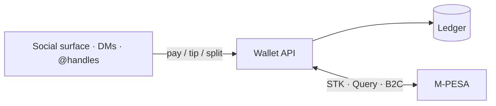

# X Money for Kenya

### You’re in a DM with `@baraka`. You owe them lunch.

Today you leave the app, open M-PESA, type a phone number, hope it’s the right one, and come back.  
**What if the social app just… paid them?**

This sandbox is a working sketch of that missing piece: **how a social platform wires a local rail like M-PESA into the product**, so money moves to an **@handle** where the conversation already is — not through a card form, not through a separate remittance app.

Not a new payment network. Remittance products already push cash into M-PESA.  
The interesting problem is the **integration**: identity, wallet, handshake with the rail, and books that still balance when Safaricom’s callbacks arrive twice, late, or never.

[](https://github.com/benweru/xmoney-kenya/actions/workflows/ci.yml)
[](docs/evidence/README.md)
[](docs/adr/)

> **Sandbox only · not a payment service · not affiliated with X Corp, Safaricom, or IntaSend.**  
> No CBK licence. **Cannot move real money.** Refuses to boot outside sandbox; Daraja client only talks to `sandbox.safaricom.co.ke`.

<p>
  
  
  
  
</p>

`make demo` → wallet on <http://localhost:3000>. Live URL (when up) is listed in [docs/evidence](docs/evidence/README.md).

---

## The bet

**Social platforms that win in markets like Kenya won’t bolt on Visa and call it done.**  
They’ll meet people where the money already lives — M-PESA — and make **@handles** first-class payment addresses.

| Old path | This path |
| --- | --- |
| Leave the app → pay a phone number | Stay in the app → pay `@baraka` |
| Card / GlobalPay for local P2P | STK Push · KES · no card |
| Trust the webhook | **Handshake** — credit only after the rail confirms |
| “Callbacks are fine, right?” | Idempotency · DB state machines · recon when worlds disagree |

Same idea elsewhere: swap M-PESA for whatever local instant rail the market already uses. This repo is the **Kenya instance** of that pattern — framed as what an X Money–style expansion would need to *study*, not announce.

More framing: [`docs/positioning.md`](docs/positioning.md).

---

## What “done carefully” looks like

Anyone can call an STK API. The portfolio question is whether you’d trust the **layer between the feed and the phone**:

1. **@handle identity** — pay the person you follow, not a raw MSISDN in the UI  
2. **Phone → in-app wallet** — STK top-up into a double-entry ledger (integer cents, no floats)  
3. **Handshake** — credit after **STK Query** says paid; timeouts are honest failures; late pays still settle cleanly  
4. **In-app send** — no overdraft, ordered locks (no deadlocks), same key never double-sends  
5. **When M-PESA and the app disagree** — classify the break; fix with suspense / reversals — never rewrite history  

Proof artifacts (chaos, correctness, security, cost) live in [`docs/evidence/`](docs/evidence/README.md) so this page doesn’t rot every sprint. Why we chose each mechanism: [`docs/adr/`](docs/adr/).

---

## Shape of the system



The clever bit isn’t Safaricom’s API. It’s everything that keeps **social UX** and **an unreliable external rail** from inventing or losing money.

---

## Stack

FastAPI · Postgres 16 · SQLAlchemy/Alembic · Next.js wallet + `/console` · Playwright · Terraform/AWS demo · `PaymentsProvider` (mock ↔ Daraja sandbox).

---

## Run it

```bash
make demo
```

API docs: <http://127.0.0.1:8000/docs> · [CONTRIBUTING.md](CONTRIBUTING.md) · [runbooks](docs/runbooks/) · deep API notes → [`docs/developer-reference.md`](docs/developer-reference.md) when present.

`X-Sandbox: true` · `X-Moves-Real-Money: false` on every response.

---

## Reality check

This is the **shape** of a social×M-PESA wallet, not a licence to run one. Production still needs CBK/PSP authorisation, a real shortcode and settlement, KYC/AML, Data Protection Act duties, safeguarded funds. Roadmap: [`docs/roadmap.md`](docs/roadmap.md).

---

## Five-minute tour

1. Read **The bet**.  
2. [`docs/positioning.md`](docs/positioning.md) — why not “just GlobalPay?”  
3. [`docs/evidence/`](docs/evidence/README.md) — what we can measure.  
4. ADRs: [ledger](docs/adr/002-ledger-design.md) · [STK Query before credit](docs/adr/009-stk-query-before-credit.md) · [recon](docs/adr/015-reconciliation.md).  
5. `make demo` — top up, send lunch to `@baraka`.

---

Portfolio sandbox · [CONTRIBUTING.md](CONTRIBUTING.md) · **not for production money.**
