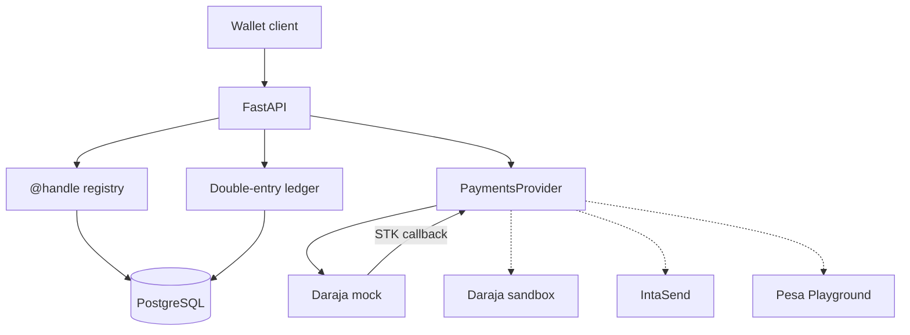
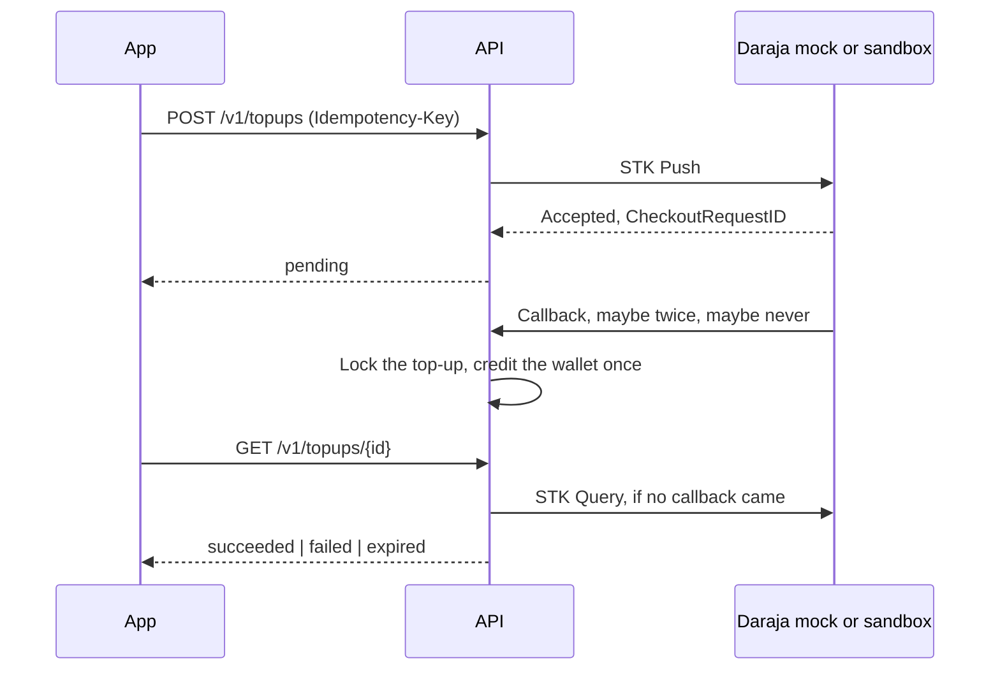

# X Money for Kenya

A sandbox prototype of a pay-by-**@handle** wallet: people register a case-insensitive handle and a Kenyan mobile number, each gets a wallet, and a double-entry ledger records value in integer Kenya-shilling cents. Later milestones connect top-ups and cash-outs to M-PESA. The code here today is the foundation those flows will sit on.

> **Sandbox only. This is not a payment service, and it is not affiliated with X Corp.**
>
> "X Money for Kenya" is the name of an independent portfolio project. It is not built, endorsed, or sponsored by X Corp. (or its X Money product), Safaricom, or IntaSend. It does not hold a Central Bank of Kenya licence and **cannot move real money**. The process refuses to start unless sandbox mode is on, and both the settings loader and the Daraja client refuse every Safaricom host except `sandbox.safaricom.co.ke`. Nothing in this repository is an offer to store, transmit, or settle customer funds.

## What a Kenya launch would need

The software in this repo is the shape of a wallet, not permission to run one. A real launch would still need, and this project does not provide:

- Central Bank of Kenya authorisation, or a written arrangement with a licensed payment service provider.
- A production M-PESA agreement: a paybill or shortcode, settlement accounts, and Daraja credentials that are not the public sandbox.
- Customer identification and suspicious-transaction reporting under the Proceeds of Crime and Anti-Money Laundering Act.
- Registration and duties under the Data Protection Act, 2019 (Office of the Data Protection Commissioner).
- Safeguarding of customer funds, a complaints process, and clear consumer disclosure.

Milestone M4 of the roadmap is a write-up of that gap. It is not a shortcut through it.

## Repository layout

```text
api/        FastAPI backend: ledger, @handles, payments seam, Daraja mock, Alembic, pytest
web/        Next.js + TypeScript wallet app (placeholder for now)
docs/adr/   architecture decision records
docker/     Postgres init scripts for docker compose
```

Design decisions live in [`docs/adr/`](docs/adr/): [001 stack](docs/adr/001-stack-choice.md), [002 ledger](docs/adr/002-ledger-design.md), [003 AWS hosting](docs/adr/003-aws-hosting-terraform-later.md), [004 sign-in](docs/adr/004-pin-otp-sign-in.md), [005 STK top-ups](docs/adr/005-stk-topup-state-machine.md).

## Architecture



Solid arrows are week 1. Dashed arrows are the same `PaymentsProvider` seam, not wired yet.

An STK top-up ([ADR 005](docs/adr/005-stk-topup-state-machine.md)):



## Ledger

Money is an integer number of **cents**. 1 KES = 100 cents. There are no floats. M-PESA itself collects whole shillings, so the STK adapter rejects an amount that is not divisible by 100. The ledger keeps cents so a later fee can be a fraction of a shilling without ever leaving integers.

Balances are not a column. They are the sum of postings. Asset and expense accounts are debit-normal. Liability, equity, and income accounts are credit-normal. A wallet is a liability: we would owe the customer that balance.

| Account | Type | What it is for |
| --- | --- | --- |
| `system:mpesa_float` | Asset | Cash held at M-PESA |
| `system:mpesa_clearing` | Asset | STK or B2C value still in flight |
| `system:fees` | Income | Fees |
| `system:suspense` | Liability | Value we owe but cannot apply to a wallet yet |
| `wallet:{user}` | Liability | One wallet per registered handle |

A 100.00 KES collection with a 1.00 KES fee will eventually post as:

| Account | Debit (cents) | Credit (cents) |
| --- | ---: | ---: |
| M-PESA float | 10000 | |
| Wallet @amina | | 9900 |
| Fee income | | 100 |

Every journal entry has an idempotency key. Replaying the same key and the same postings returns the original entry and does not move balances again. The same key with a different body is a conflict. Posting order does not matter for that comparison.

PostgreSQL enforces the rules the application also checks:

- Debits equal credits, and there are at least two postings, via a deferred constraint trigger.
- Amounts are positive bigint cents.
- Postings, journal entries, and accounts cannot be updated, deleted, or truncated.
- Postings can only be added in the transaction that created their journal entry, so a committed entry cannot gain new lines later.
- Handles are unique case-insensitively, phones are unique, and each user has one wallet.

Week 1 does **not** refuse an overdraft. A wallet can go negative. Spend limits arrive with peer transfers in M1. The books still have to balance: total debits equal total credits, and the test suite checks that after every test.

`POST /v1/sandbox/journal-entries` exists so the ledger can be demonstrated. It is not the customer top-up API. Top-ups post from the STK callback, not from this route.

## Handles

`POST /v1/users` takes a handle, a phone, and a 4–6 digit PIN. The handle is stored lowercase, without `@`, and is unique regardless of case. It is 3–20 characters, starts with a letter, and may contain letters, digits, and underscores. Names such as `admin`, `mpesa`, and `xmoney` are reserved.

The phone must be E.164 for a Kenyan mobile: `+254` then `7` or `1` and eight more digits. Spaces and dashes are ignored. A local `07…` number is rejected so the stored form is always E.164.

`GET /v1/handles/{handle}` resolves a handle to its wallet. It does not return the phone number.

## Sign-in

Sign-in takes two steps, as in [ADR 004](docs/adr/004-pin-otp-sign-in.md):

1. `POST /v1/auth/sign-in` with the phone and PIN. On success, a 6-digit code goes to the **sandbox inbox** (the demo's stand-in for SMS), and the response carries a `challenge_id`.
2. `POST /v1/auth/verify` with the `challenge_id` and the code. The response sets an `httpOnly` session cookie, `xmoney_session`.

`GET /v1/me` returns the signed-in user. `POST /v1/auth/sign-out` revokes the session. PINs are stored only as Argon2id hashes, and trivial PINs such as `1111` and `1234` are refused. Five wrong PINs in a row lock sign-in for 15 minutes. A code lasts 5 minutes, allows 5 guesses, and works once. `GET /v1/sandbox/inbox?phone=…` lists the latest messages for a phone. Anyone can read it, which is acceptable only because this is a sandbox.

## Top-ups

`POST /v1/topups` (signed in, with an `Idempotency-Key` header) sends an STK Push for `amount_cents` to the user's phone, or to `phone` if given. M-PESA collects whole shillings, so the amount must be a multiple of 100 cents, up to KES 250,000. The response is `pending`. Poll `GET /v1/topups/{id}` until it is `succeeded`, `failed`, or `expired`.

- Daraja's callback goes to `/v1/payments/stk/callback/{token}`. Only the first final answer for a `CheckoutRequestID` changes anything. The status change and the wallet credit (debit `system:mpesa_float`, credit the wallet) commit in one transaction. Every callback, including duplicates, is kept in `stk_callbacks`.
- A callback that arrives before the push response has been saved is applied as soon as it is.
- If no callback has come after `STK_QUERY_AFTER_SECONDS` (60), reading the top-up asks Daraja's STK Query API, at most every 15 seconds. `make resolve-topups` does the same for every waiting top-up. After `STK_EXPIRE_AFTER_SECONDS` (300) with no answer, the top-up is `expired`. A late "paid" callback still credits it.
- Replaying an `Idempotency-Key` returns the same top-up. Reusing it for a different amount is a 409.
- Postgres enforces the allowed transitions, so `succeeded` can never go back to `pending`.

`make smoke-topup PHONE=+254712345000` runs one top-up through a running API. The [Daraja sandbox runbook](docs/runbooks/daraja-sandbox-top-up.md) does the same against Safaricom's sandbox with your own credentials.

## M-PESA simulator

[Pesa Playground](https://github.com/OmentaElvis/pesa-playground) is a local M-PESA simulator and a good interactive tool. It is a Rust/Tauri desktop app (and a Docker image aimed at that UI), and its roadmap targets Daraja 3.0. It is not a Python library the test suite can import, and a GUI is the wrong place to assert that a callback was dropped. Week 1 therefore ships a small Daraja-compatible mock behind `PaymentsProvider`.

The adapter is `DarajaHttpProvider`. `DARAJA_BASE_URL` points it at this mock by default, or at the Daraja sandbox (`sandbox.safaricom.co.ke` is allowed; `api.safaricom.co.ke` and every other Safaricom host are not, and the app refuses to start if `DARAJA_BASE_URL` points at one). An IntaSend adapter would implement the same protocol. The mock never touches the ledger. Only the top-up flow credits a wallet.

The mock exposes:

- `GET /sandbox/daraja/oauth/v1/generate?grant_type=client_credentials` with HTTP Basic auth. Any non-empty key and secret work. The sample credentials are `sandbox` / `sandbox`.
- `POST /sandbox/daraja/mpesa/stkpush/v1/processrequest` with the usual Daraja body. The provider sends `X-Idempotency-Key`. Replaying it returns the same `CheckoutRequestID` and does not fire a second callback. A different body with the same key is HTTP 409.
- An asynchronous callback to `CallBackURL`.
- `POST /sandbox/daraja/mpesa/stkpushquery/v1/query`. It answers "still processing" (HTTP 500, `500.001.1001`) until the configured delay has passed, then gives the same result the callback carried. That includes pushes whose callback was dropped.

The last three digits of the MSISDN pick the outcome. Any other number uses the default, which starts as success with no delay.

| Suffix | What the mock does |
| --- | --- |
| `000` | Success, ResultCode 0, receipt prefixed `SBOX` |
| `032` | Cancelled by the user, 1032 |
| `037` | Timeout, handset unreachable, 1037 |
| `001` | Insufficient funds, 1 |
| `099` | The push is accepted and the callback is never sent |
| anything else | The configured default |

`PUT /sandbox/daraja/__control/behavior` sets that default: `outcome` (`success`, `cancelled`, `timeout`, `insufficient_funds`), `delay_ms` (0–10000), and `drop_callback`. Suffix `099` still drops. Other suffixes still force their outcome, and they wait for the configured delay.

## Run it locally

Requirements: Docker, Python 3.12, Node.js 22.

The whole stack in containers (Postgres, the API with its Daraja mock, and the web app):

```bash
make demo
```

For development, run Postgres in Docker and the apps on your machine:

```bash
make setup      # api/.venv and web/node_modules
make up         # Postgres only
make migrate
make run        # API with reload
make run-web    # web app, in another terminal
```

The API listens on <http://127.0.0.1:8000>. Interactive docs are at <http://127.0.0.1:8000/docs>. The web app listens on <http://127.0.0.1:3000>. `api/.env.example` lists the sandbox variables. `make setup` copies it to `api/.env` if you do not already have one.

```bash
curl -s localhost:8000/health

curl -s -X POST localhost:8000/v1/users \
  -H 'content-type: application/json' \
  -d '{"handle":"@amina","phone":"+254712345678","pin":"2580"}'

curl -s localhost:8000/v1/handles/amina

# Sign in: PIN first, then the code from the sandbox inbox.
curl -s -X POST localhost:8000/v1/auth/sign-in \
  -H 'content-type: application/json' \
  -d '{"phone":"+254712345678","pin":"2580"}'          # note the challenge_id
curl -s 'localhost:8000/v1/sandbox/inbox?phone=%2B254712345678'
curl -s -c cookies.txt -X POST localhost:8000/v1/auth/verify \
  -H 'content-type: application/json' \
  -d '{"challenge_id":"<challenge_id>","code":"<code>"}'
curl -s -b cookies.txt localhost:8000/v1/me

curl -s -u sandbox:sandbox \
  'localhost:8000/sandbox/daraja/oauth/v1/generate?grant_type=client_credentials'
```

Every response carries `X-Sandbox: true` and `X-Moves-Real-Money: false`.

### Tests

```bash
make lint        # ruff, mypy, ESLint, and Prettier
make test        # pytest for the API, typecheck and build for the web app
make migrate-check
make pre-commit  # every pre-commit hook against every file
```

`make setup` installs the [pre-commit](https://pre-commit.com/) hooks in `.pre-commit-config.yaml`: ruff (lint and format) and strict mypy for `api/`, ESLint and Prettier for `web/`, plus whitespace and YAML/TOML/JSON checks. Branch naming and the PR flow are in [CONTRIBUTING.md](CONTRIBUTING.md).

Pytest always uses the `xmoney_test` database, so a run does not wipe wallets in the dev database. The suite is serial: tests share one schema and truncate it between cases (the fixture sets `xmoney.allow_truncate` for that one statement). GitHub Actions runs three jobs: `api` (ruff, mypy, migrations, `alembic check` for model drift, a downgrade/upgrade round trip, and pytest against Postgres 16), `web` (ESLint, Prettier, typecheck, build), and `compose` (builds the demo stack and smoke-tests both apps).

Coverage that matters for a ledger:

- Derived balances, including a three-leg fee split.
- Idempotent replay, including the same postings in a different order, and a conflict when the body differs.
- Concurrent distinct posts sum exactly. Concurrent posts of one idempotency key apply once.
- The database, not only the service, rejects an unbalanced entry, an entry with no postings, a non-positive amount, and any update or delete of a posting.
- Two registrations of the same handle cannot both win.
- Sign-in: PINs are Argon2id hashes, wrong PINs lock the account (parallel guesses are each counted), and codes expire, die after 5 guesses, and work once. Signed-out session tokens stop working.
- The mock delivers success, cancel, timeout, and insufficient-funds callbacks, waits when asked, and can drop a callback.
- Top-ups: duplicate callbacks (including 10 concurrent copies) credit once; a callback that beats the push response is applied; a dropped callback is recovered with STK Query; a late success after expiry still credits; contradicting, wrong-amount, unknown, and forged (wrong token) callbacks move no money; Postgres rejects illegal transitions.

## Roadmap

The full plan, with each milestone's scope, what it proves, and when it is done, is in [docs/roadmap.md](docs/roadmap.md).

| Milestone | What lands |
| --- | --- |
| M0 | Week 1 foundation merged, `api/` + `web/` layout, first ADRs |
| M1 | Money moves: STK top-up state machine, send by @handle, sign-in |
| M2 | The wallet app and a public demo |
| M3 | Money correctness: outbox, B2C cash-out, reconciliation, suspense, operations console |
| M4 | Risk and compliance: KYC tiers, rules engine, sanctions screening, Data Protection Act |
| M5 | Production readiness: rate limits, observability, load and chaos tests, threat model |
| M6 | Merchant platform (stretch) |
