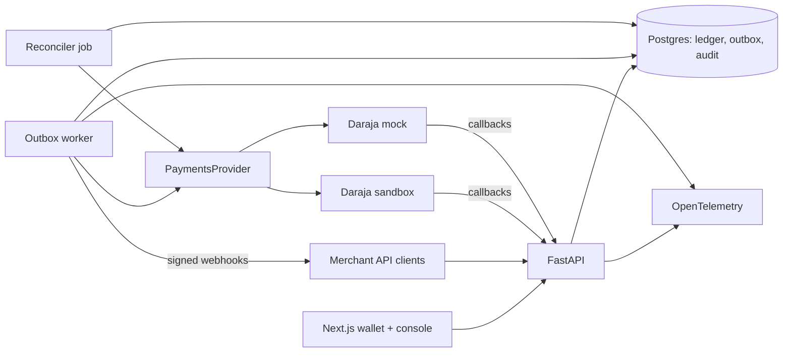

# xmoney-kenya roadmap (revised)

Sandbox-only. Nothing here ever moves real money. The app refuses to start outside sandbox mode, and the Daraja client refuses the production host. Every milestone keeps those rules.

Design decisions are recorded as ADRs in [`docs/adr/`](adr/README.md).

## Vision

X Money for Kenya is a pay-by-@handle wallet. You top up from M-PESA, send to `@amina` instead of a phone number, and cash back out to M-PESA. It runs only against the Daraja sandbox and a local mock. The point is not the features. The point is to show the hard parts of a real wallet done carefully: a double-entry ledger that cannot be unbalanced, money movements that happen exactly once even when callbacks are lost or duplicated, daily reconciliation against what M-PESA says happened, and the risk, compliance, and operations tooling a licensed provider would need. A fintech reviewer should come away thinking "this person already knows what goes wrong with money."

## What a reviewer sees in 5 minutes

1. **README, top of the page**: a one-line pitch, a disclaimer ("Sandbox-only. Not affiliated with X Corp or Safaricom."), a **Live demo** link, a 30-second GIF of a top-up and a send, and CI/coverage badges.
2. **"Why this is interesting"**: five bullets, each linking to code or a doc. For example: ledger invariants enforced by Postgres triggers, exactly-once STK callbacks, reconciliation against Daraja Transaction Status, a case queue for AML alerts, and k6 results at N requests per second.
3. **Screenshots**: the wallet app (home, send, history) and the back-office console (reconciliation breaks, case queue).
4. **One architecture diagram** (app and AWS) and links to `docs/adr/`, `docs/threat-model.md`, and `docs/compliance.md`.
5. **Try it in one command**: `make demo` (docker compose: API, worker, web, Postgres, Daraja mock, seeded users).

The public demo is fully open, with no password. It has seeded accounts such as `@amina` and `@baraka`, a "sandbox inbox" that shows one-time codes instead of sending SMS, per-IP and per-user rate limits, and a nightly reset. A rail switch lets a visitor top up through the **real Daraja sandbox** (using the project's sandbox credentials and test MSISDN) or through the mock.

## Recommended stack and architecture

| Layer | Choice | Why |
| --- | --- | --- |
| API | FastAPI, SQLAlchemy, Alembic, Postgres 16 (already in place) | Keep it. It is good, and switching stacks is low-signal. |
| Background work | A Python worker that reads a Postgres outbox table (`FOR UPDATE SKIP LOCKED`) | Gives retries and a dead-letter queue (DLQ) with no Kafka or Celery to run. You can explain every line. |
| Web app | Next.js (App Router, static export) with TypeScript, Tailwind and shadcn/ui, TanStack Query, and a client generated from FastAPI's OpenAPI (`openapi-typescript`) | The most common full-stack fintech frontend. Typed end to end. Installable as a PWA. Static export lets S3 + CloudFront serve it. |
| Back-office console | Same Next.js app, under `/console`, with staff roles | One deploy, shared components, and a real authorization boundary to show off. |
| Tests | pytest (API), Playwright (end-to-end UI), k6 (load) | Each is the standard choice for its job. |
| Observability | OpenTelemetry through the AWS Distro for OpenTelemetry (ADOT) to CloudWatch and X-Ray | Real dashboards you can screenshot, and it is exam material. |
| Hosting | AWS, provisioned with Terraform (see below) | Reinforces the AWS Solutions Architect Associate (SAA-C03) exam and puts Terraform on the CV. |

Repo layout (a monorepo, set up in M0):

```text
api/        FastAPI app, worker, Alembic, pytest     (today's src/ + tests/)
web/        Next.js wallet + /console
infra/      docker-compose, terraform/, k6, chaos scripts
docs/       adr/, threat-model.md, compliance.md, runbooks/
```



Rule of thumb: one database, one API, one worker. Each addition has to earn its place with an ADR.

## AWS infrastructure

One region (for example `eu-west-1`), all in Terraform under `infra/terraform/`, split into two stacks so the expensive part can be destroyed without losing the rest:

- **`foundation`** (always on, near-free): Terraform state, Budgets, IAM, ECR, Secrets.
- **`app`** (destroyable): VPC, RDS, ECS, ALB, CloudFront, schedules.

| Piece | Choice | Cost note | SAA-C03 topic |
| --- | --- | --- | --- |
| Terraform state | S3 backend with versioning, encryption, and state locking | Pennies | S3 versioning and encryption |
| Network | VPC with 2 AZs: public subnets for the ALB and Fargate tasks (public IP, locked down by security groups), private subnets for RDS. **No NAT gateway.** | NAT costs about $30+/month, so skip it | VPC design, subnets, route tables, security groups vs NACLs, NAT trade-offs |
| API and worker | ECS Fargate: an API service and a worker service (worker on Fargate Spot) | Smallest task sizes. Scale to 0 when idle | Containers, ECS task vs execution roles, Spot, auto scaling |
| Container images | ECR with a lifecycle policy (keep the last 10) | Within free storage | ECR, lifecycle rules |
| Load balancer | ALB in front of the API, accepting traffic only from the CloudFront managed prefix list | About $16/month when running. Destroy with the `app` stack | ELB types, target groups, health checks |
| Web and edge | S3 (private, Origin Access Control) + CloudFront. `/api/*` routes to the ALB origin, so one HTTPS domain serves both: same-origin cookies, no CORS, and an HTTPS URL for Daraja callbacks on `*.cloudfront.net` (no domain purchase needed) | Free-tier friendly | CloudFront origins and behaviors, OAC, caching, edge security |
| Database | RDS Postgres 16, `db.t4g.micro`, single-AZ, 20 GB gp3, automated backups, encrypted | Free-tier eligible. Can be stopped for up to 7 days | RDS vs Aurora, Multi-AZ vs read replicas (document why single-AZ here), backups and snapshots |
| Secrets | Secrets Manager for the DB password and Daraja sandbox keys. SSM Parameter Store for plain config | Secrets Manager is $0.40/secret/month, so keep it to 2–3 secrets | Secrets Manager vs Parameter Store, KMS |
| Scheduled jobs | EventBridge Scheduler runs ECS tasks for the reconciler and the nightly demo reset | Free at this volume | Event-driven design, decoupling |
| Observability | CloudWatch Logs (14-day retention), metrics, alarms, one dashboard, X-Ray traces via ADOT | Keep retention short | CloudWatch, X-Ray, monitoring |
| CI/CD access | GitHub Actions assumes an IAM role through OIDC. No long-lived keys | Free | IAM roles, federation, least privilege |
| Encryption of PII (M4) | KMS key for envelope encryption of national ID numbers | $1/month per key | KMS, envelope encryption |
| Edge protection (optional, M5) | AWS WAF rate-based rule on CloudFront, in addition to app-level limits | About $6+/month, so turn it on only for demos or screenshots | WAF, Shield, DDoS |

Cost guardrails:

- **AWS Budgets** in `foundation`: alerts at $5, $10, and $20 actual spend, plus a forecast alert, emailed to you. Turn on Cost Explorer and the free-tier usage alerts.
- **Scale to near-zero**: `make aws-sleep` sets both ECS services to 0 tasks and stops RDS. `make aws-wake` reverses it. Running cost while asleep is mostly the ALB.
- **Tear down**: `make aws-down` runs `terraform destroy` on the `app` stack after taking a final RDS snapshot. `make aws-up` rebuilds it. Document both in `docs/runbooks/aws-costs.md`.
- Tag every resource (`project=xmoney-kenya`, `env=demo`) so Cost Explorer can filter by it.
- IAM least privilege: separate task roles for the API, worker, and jobs, each reading only its own secrets. Write an ADR on the IAM design and one on "why no NAT gateway".

## Milestones

Do them in order. Each one ends with the app deployed, the README updated, and at least one screenshot or GIF. That way the repo is impressive after any milestone, not only at the end.

### M0. Land the foundation and set up the repo

- **Goal**: Week 1 merged, and the repo looks deliberate from day one.
- **Scope**: review and merge [PR #1](https://github.com/benweru/xmoney-kenya/pull/1). Move to the `api/` + `web/` layout (approved). Write the first ADRs: 001 integer cents and a double-entry ledger, 002 balances derived from postings, 003 a mock-first provider seam. Add a GitHub Project board with one issue per milestone item. Add pre-commit (ruff, mypy, `terraform fmt`/`tflint`) and branch protection on `main`. Add the README disclaimer about X Corp and sandbox-only. Apply the Terraform `foundation` stack: state bucket, Budgets alerts, ECR, and the GitHub OIDC role.
- **Proves**: you can scope work and document decisions.
- **Done when**: `main` is green, ADRs 001–003 exist, the board is public, Budgets alerts are live, and the README roadmap points here.

### M1. Money moves: top-up, send by @handle, sign-in

- **Goal**: a real wallet flow through the API.
- **Scope**:
  - Sign-in with phone, a 4–6 digit PIN hashed with Argon2, and an OTP delivered to the sandbox inbox. Sessions use httpOnly cookies. Lock the account after repeated wrong PINs.
  - STK Push top-up with a payment state machine: `initiated → pending → succeeded | failed | expired`. The callback is idempotent on `CheckoutRequestID`. A pending payment with no callback is resolved by calling the STK Query API.
  - Run the same top-up tests against the mock in CI, and a manual smoke test against the real Daraja sandbox using your sandbox account.
  - P2P transfer by @handle. Refuse overdrafts (lock the wallet row or use a serializable transaction). Require an idempotency key from the client.
  - Transaction history with cursor pagination.
- **Proves**: you understand async payment rails, idempotency, and concurrency, not just CRUD.
- **Done when**: tests cover duplicate callbacks, out-of-order callbacks, dropped callbacks, and 100 concurrent sends from one wallet that never overdraw it. The ledger still balances after every test. One real sandbox STK Push has completed end to end.

### M2. The wallet app and a public demo on AWS

- **Goal**: something a non-engineer can click.
- **Scope**: Next.js PWA with sign-up, sign-in, home balance, top-up (with a visible "waiting for M-PESA" state and a mock/sandbox rail switch), send by @handle with name confirmation, history, and the sandbox inbox. Mobile-first design with real empty, loading, and error states. Apply the Terraform `app` stack (VPC, RDS, ECS Fargate, ALB, S3 + CloudFront) and deploy the API, worker, web, and mock from GitHub Actions. Daraja sandbox callbacks point at the CloudFront URL. Open demo: per-IP and per-user rate limits, caps on demo top-up amounts, seed data, and a nightly reset via EventBridge Scheduler. Add Playwright tests for the main path, run in CI.
- **Proves**: full-stack delivery, product sense, a typed API contract, and AWS infrastructure as code.
- **Done when**: the live URL works on a phone, a sandbox top-up works from the live site, `make aws-sleep`/`aws-down` are tested, the README has the GIF, screenshots, and AWS diagram, and Playwright passes in CI.

### M3. Money correctness and the operations console

This is the milestone that sets the project apart. Prioritize it over everything after it.

- **Goal**: every shilling is accounted for, even when M-PESA misbehaves.
- **Scope**:
  - **Transactional outbox**: an API call writes the business row and an outbox row in one transaction. The worker sends to the rail with exponential backoff. After N attempts the job goes to a DLQ that staff can replay.
  - **B2C cash-out**: put the funds on hold, call B2C, then settle or release on the result callback. Handle B2C timeouts.
  - **Fee engine**: versioned fee schedules (flat plus percentage, bands, a free P2P allowance). Each transaction stores the fee version it used.
  - **Reconciliation**: a daily job (EventBridge Scheduler → ECS task) compares the ledger with Daraja Transaction Status results (and with a mock settlement file). It classifies each break: missing on our side, missing on theirs, or amount mismatch.
  - **Suspense workflow**: money we cannot match goes to `system:suspense`. Staff resolve it to a wallet or a refund, with a reason.
  - **Reversals and refunds**: these are always new compensating entries, never edits. Large reversals need a second staff approver (maker-checker).
  - **Console v1**: user lookup, ledger explorer, reconciliation breaks, suspense queue, DLQ replay, and an audit log of every staff action.
- **Proves**: the thing fintech teams worry about most. You can talk through failure modes in an interview.
- **Done when**: a failure-injection test suite (callback dropped, duplicated, or late; worker killed mid-job; Daraja 500s) ends with zero unexplained differences. ADRs cover the outbox, reconciliation, and reversals. A runbook explains how to clear a suspense item.

### M4. Risk and compliance

- **Goal**: show you know a wallet is a regulated product.
- **Scope**:
  - **KYC tiers**: Tier 0 is phone-only with low limits. Tier 1 adds a national ID checked against a **mocked IPRS** service. Tier 2 is "enhanced" with manual review. Per-transaction, daily, and balance limits live in config, and an ADR cites the sources (Safaricom's published M-PESA limits, CBK National Payment System Regulations 2014). Do not invent official numbers.
  - **Rules risk engine**: velocity, new-device, new-payee, round-amount, and structuring rules. Each returns a score and reasons, and the engine decides allow, step-up (ask for OTP again), or hold. Add one simple statistical anomaly check (a z-score against the user's own history). Skip machine learning.
  - **Sanctions screening**: fuzzy name matching against a checked-in snapshot of the UN consolidated list, run at Tier 1 sign-up and on recipients.
  - **Case queue** in the console: alerts become cases. Staff assign, add notes, and close them as cleared or escalated (a mock suspicious-transaction report export).
  - **Data Protection Act 2019** write-up and features: data minimization, field-level encryption for national ID numbers (KMS envelope encryption), a retention policy, and a data-subject export. Explain how you meet a "delete my data" request when ledger rows can never be deleted: pseudonymize the person, keep the money records.
- **Proves**: domain depth that most candidates' projects have none of.
- **Done when**: limits block over-limit transfers in tests, a seeded structuring scenario produces a case, and `docs/compliance.md` maps each feature to the law or rule it addresses.

### M5. Production readiness

- **Goal**: evidence it would survive real traffic and real attackers.
- **Scope**: harden the rate limiting from M2 (optional WAF rate-based rule on CloudFront). A callback IP allowlist (Safaricom publishes its callback IPs) plus a secret token in the callback URL. TOTP two-factor for console staff. Security headers and CSRF protection. OpenTelemetry traces across API, worker, and rail calls in X-Ray. Two or three SLOs (for example, 99% of P2P sends under 300 ms, and top-up callbacks applied within 5 s) with a CloudWatch dashboard and alarms. A k6 load test with results committed to the repo. Chaos tests using Toxiproxy (latency and dropped connections to Postgres and the rail). A STRIDE threat model. CI/CD: tests, then `terraform plan` on PRs, then production deploy on a tag, with database migrations as a gated ECS task. Optional exam exercise: document (or briefly enable) Multi-AZ RDS and ECS auto scaling, then turn them off.
- **Proves**: you can run software, not only write it.
- **Done when**: the README shows the k6 numbers and a dashboard screenshot, `docs/threat-model.md` lists each threat with its mitigation and a test, and deploys happen only from CI.

### M6. Merchant platform (stretch, high signal)

- **Goal**: show you can design an API for other developers.
- **Scope**: merchant accounts. API keys stored hashed, with a visible prefix and scopes. A `POST /v1/payments` endpoint with an `Idempotency-Key` header. Webhooks signed with HMAC and a timestamp (like Stripe), with retries and a delivery log in the console. Lipa QR: a merchant shows a QR code and the PWA scans it and pays. Payment requests ("@amina requests KES 500") with accept or decline. A short developer docs page and a tiny sample "checkout" site in `examples/` that uses the API.
- **Proves**: API design and developer experience, the work that Stripe-, Flutterwave-, and Paystack-style teams do.
- **Done when**: the sample merchant takes a QR payment end to end on the live demo, and webhook signature verification has tests for good, tampered, and replayed requests.

## Cut or defer

| Item | Decision | Reason |
| --- | --- | --- |
| Cross-border remittance with FX quotes | Defer, and maybe never do it | A big compliance and FX surface with little new engineering signal after M3. If you do it, build only a quote-and-lock endpoint with expiring quotes. |
| Native mobile app | Cut. Build a PWA. | It doubles the frontend work for the same story. |
| Machine-learning anomaly model | Cut. Use rules plus a z-score. | Explainable rules are what real risk teams start with, and you can defend them in an interview. |
| Bill splitting | Defer to after M6 | It is a UI on top of payment requests and adds little backend depth. |
| NAT gateway, Multi-AZ RDS, always-on WAF | Cut for cost. Document them in ADRs. | Explaining the trade-off covers the exam topic without the monthly bill. |
| Kubernetes (EKS), microservices, Kafka, Redis queues | Cut | One API and one worker is the correct architecture at this scale, and saying so is a senior signal. |
| IntaSend or other provider adapters | Defer | The `PaymentsProvider` seam already makes the point. |
| Pesa Playground integration | Cut | It is a desktop GUI and cannot run in CI (see the Week 1 notes). |

## GitHub presentation tips

- **README**: lead with the demo and GIF, then "why this is interesting," then architecture, then how to run it. Move long reference sections (mock outcome codes, ledger tables) into `docs/`. Keep the sandbox and "not affiliated with X Corp" disclaimer near the top.
- **Pin the repo** on your profile and add a profile README with one line about the project and a link to the demo.
- **Issues and project board**: one issue per scoped task, labeled by milestone (`m3-correctness`, and so on). Close issues from PRs ("Closes #12"). This shows a planning trail.
- **PRs**: open small PRs even when working alone. Each one gets a description (what, why, how it was tested) and a green CI check. Squash-merge so `main` reads as a clean list of features.
- **Commits**: imperative, specific messages ("Apply STK callback idempotently on CheckoutRequestID"). Do not use "wip" or "fix stuff" on `main`.
- **Docs**: `docs/adr/NNN-title.md` (context, decision, consequences), `docs/threat-model.md`, `docs/compliance.md`, and `docs/runbooks/`. Short and honest beats long. Write "known limitations" sections.
- **Releases**: tag each milestone (`v0.1-m1`, and so on) with release notes and a screenshot.
- **Interview prep**: for each milestone, keep a three-bullet story in `docs/`: the failure mode, how you handled it, and how you tested it. Add an SAA-C03 note per AWS piece: which exam domain it covers and the alternative you rejected.

## Open decisions

None right now. Resolved decisions are recorded as ADRs in [`docs/adr/`](adr/README.md).
